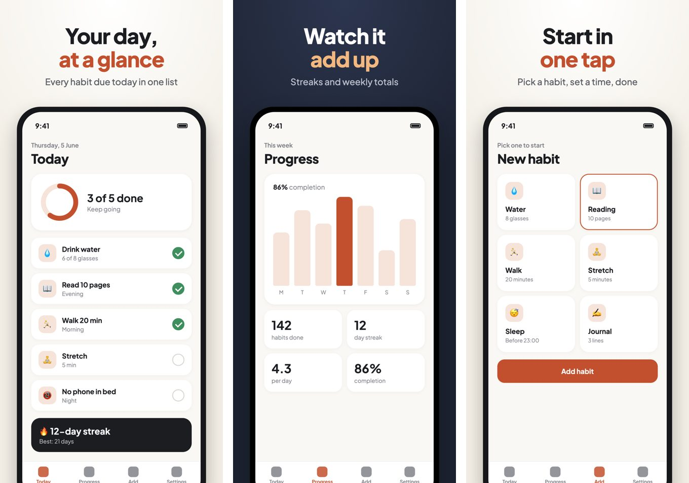
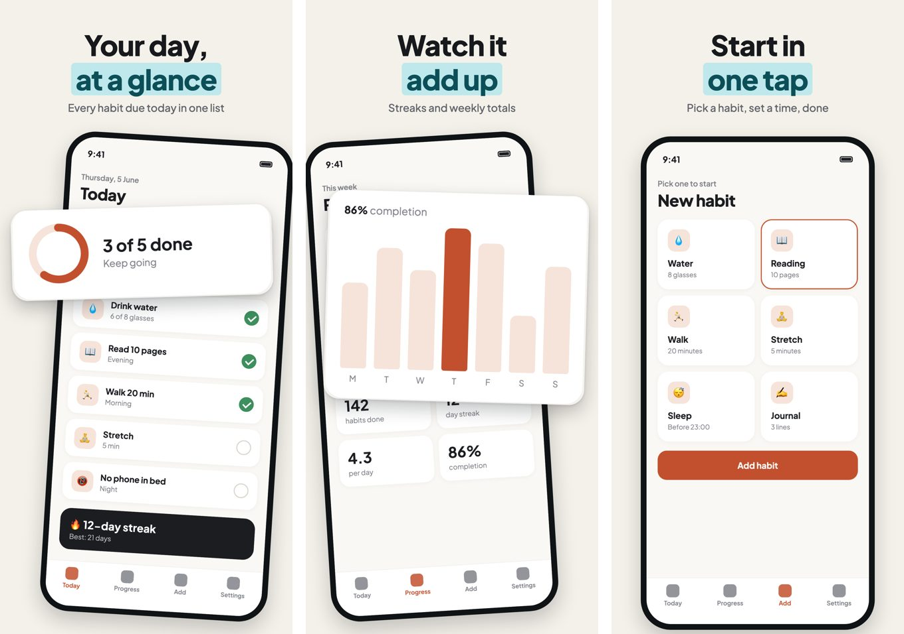

# Agent skills

Skills for coding agents that read `SKILL.md` files.
Each folder in `skills/` is self-contained: instructions plus the scripts it runs.

## Store launch

Get an iOS + Android app through App Store and Google Play review the first time, with listings and screenshots in
every language. Built from real submissions and real rejections.

| Skill | What it does |
|---|---|
| [`store-ready`](skills/store-ready/SKILL.md) | The full order to both stores, every review trap we've hit and its fix, App Store Connect setup by API, Play Console forms, submit and resubmit |
| [`store-listings`](skills/store-listings/SKILL.md) | Title, subtitle, keywords, descriptions, What's New per language; pushed to both stores from files in your repo |
| [`store-screenshots`](skills/store-screenshots/SKILL.md) | Capture per language, then exact-size framed screenshots for every slot + Play feature graphic, then upload |




## Install

With the [skills CLI](https://github.com/vercel-labs/skills):

```bash
npx skills add AhmedAshour/agent-skills                      # pick skills interactively
npx skills add AhmedAshour/agent-skills --skill store-ready  # just one
```

Or copy folders from `skills/` into your agent's skills directory (e.g. `~/.claude/skills/`, `~/.agents/skills/`).

The screenshot kit needs its dependencies once:

```bash
cd <skills dir>/store-screenshots/kit && npm ci && npx playwright install chromium
```

Then ask your agent things like "get this app store-ready", "write the store listing in English, German and Arabic",
or "make the store screenshots".

## Keys

Store keys stay on your machine. Nothing here sends them anywhere except Apple's and Google's APIs.

- **App Store Connect API key** (Users and Access › Integrations › Team Keys, role App Manager):
  ```bash
  mkdir -p ~/.config/asc && cat > ~/.config/asc/config.env <<'X'
  ASC_ISSUER_ID=...
  ASC_KEY_ID=...
  ASC_PRIVATE_KEY_PATH=/absolute/path/AuthKey_XXXX.p8
  X
  ```
  (or export the same three variables).
- **Google Play service account**: Google Cloud › IAM › service account › JSON key; enable the Google Play Android
  Developer API; invite the account's email in Play Console › Users and permissions.
  `export GOOGLE_PLAY_SERVICE_ACCOUNT_PATH=/path/key.json`

## Try it without an app

```bash
cd examples/demo-app
node mock/make-raws.mjs                                         # fake captures, en/de/ar
node ../../skills/store-screenshots/kit/render.mjs --root=.     # 57 images in app_store/screenshots/

cd ../lifted-cards-demo
python3 ../../skills/store-screenshots/styles/lifted-cards/prep-raw.py --root=. --src=../demo-app/mock/captures
node ../../skills/store-screenshots/kit/render.mjs --root=.
```

Needs Node 20+, and Python 3 with Pillow for the lifted-cards style. Real captures need the Xcode simulator or an
Android emulator.

## License

MIT, see [LICENSE](LICENSE). Bundled fonts are under the SIL Open Font License (`skills/store-screenshots/styles/fonts/`).
Not affiliated with Apple or Google; store rules change, so check their current guidelines when something disagrees.
